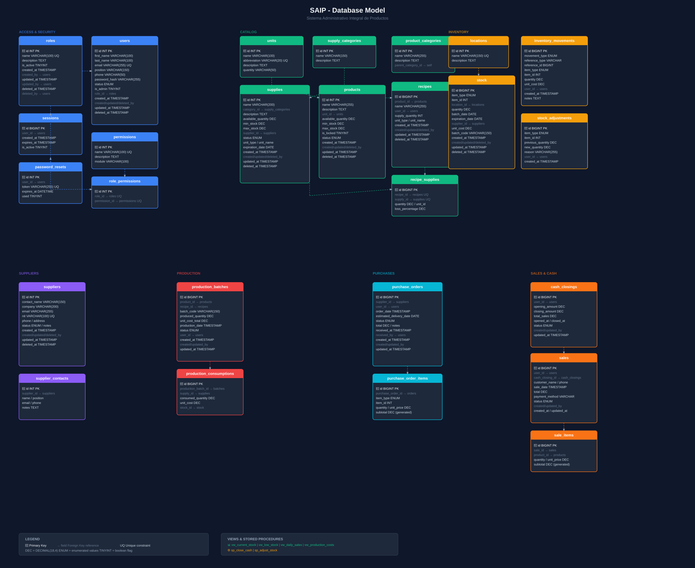

# SAIP - Sistema Administrativo Integral de ProductosHOLA

## Objetivo del Proyecto

SAIP es un **Sistema Administrativo Integral de Productos** en plataforma web, diseñado específicamente para pequeñas panaderías como La Parmesana. El proyecto se encuentra en fase activa de desarrollo con los siguientes objetivos:

- Automatizar y optimizar procesos clave: ventas, inventario, compras, proveedores, producción de materias primas y administración básica.
- Centralizar la información mediante formularios digitales y consultas en tiempo real.
- Reducir errores humanos, pérdidas económicas y carga laboral manual.
- Mejorar la precisión en registros, trazabilidad de producción y proveedores.
- Facilitar la toma de decisiones estratégicas y aumentar la rentabilidad.
- Sentar las bases para escalar a otras panaderías de mediana y amplia capacidad en fases futuras.

## Estado del Proyecto

El sistema se desarrolla de forma iterativa. A continuación se muestra el estado actual de cada módulo:

| Módulo | Backend | Frontend | Estado |
|--------|---------|----------|--------|
| **Autenticación** (login/logout, JWT, bloqueo, rate-limiting en login) | Completo | Completo | ✅ Completado |
| **Usuarios** (CRUD, soft-delete, recuperación de contraseña) | Completo | Completo | ✅ Completado |
| **Roles y permisos** (CRUD, asignación de módulos por rol) | Completo | Completo | ✅ Completado |
| **Unidades de medida** (CRUD) | Completo | Completo | ✅ Completado |
| **Categorías de insumos** (CRUD) | Completo | Completo | ✅ Completado |
| **Insumos** (materias primas, CRUD, importación Excel) | Completo | Completo | ✅ Completado |
| **Productos** (CRUD, bloqueo, importación Excel) | Completo | Completo | ✅ Completado |
| **Categorías de productos** (CRUD) | Completo | Completo | ✅ Completado |
| **Productos comerciales** (CRUD, importación Excel) | Completo | Completo | ✅ Completado |
| **Proveedores y contactos** (CRUD con contactos anidados) | Completo | Completo | ✅ Completado |
| **Recetas** (CRUD con ingredientes anidados) | Completo | Completo | ✅ Completado |
| **Reportes** (reportes Excel/JSON descargables) | Completo | Completo | ✅ Completado |
| **Órdenes de producción** (ciclo de vida y snapshot) | Completo | Completo | ✅ Completado |
| **Ventas** (alta, listado, anulación en 24 h) | Completo | Completo | ✅ Completado |
| **Inventario** (movimientos, summary y reporte) | Completo | Completo | ✅ Completado |
| **Auditoría** (registro de acciones críticas, solo admin) | Completo | — | ✅ Completado |
| **Órdenes de compra** | No implementado | No implementado | ❌ Pendiente |

> El detalle de la deuda pendiente (fases 3 y 5, entre otros) está en
> [`docs/PENDIENTES.md`](./docs/PENDIENTES.md).

## Stack Tecnológico

| Capa | Tecnología |
|------|------------|
| **Frontend** | React 19 + TypeScript + Vite + pnpm + TanStack Query |
| **Backend** | Python 3.14 + FastAPI + SQLModel + PyMySQL |
| **Base de datos** | MySQL 8.0 (Docker) |
| **Migraciones** | Alembic |
| **Autenticación** | JWT + bcrypt + sesiones por token |
| **Reportes** | Pandas + openpyxl (Excel) |
| **Rate-limiting** | SlowAPI (login 5/min, recuperación 3/min) |
| **Logging** | JSON estructurado con `X-Request-ID` |
| **Correo** | SMTP (bienvenida, recuperación, desactivación) |
| **Pruebas** | pytest (backend) + ESLint/Vite build (frontend) |
| **Orquestación** | Docker Compose (dev y prod) |

---

## Proceso de Instalación

### Requisitos previos

- [Docker](https://www.docker.com/get-started/) y Docker Compose
- [Node.js](https://nodejs.org/) (v18+)
- [pnpm](https://pnpm.io/installation) (`npm install -g pnpm`)
- [Python](https://www.python.org/) 3.14
- [uv](https://github.com/astral-sh/uv) (`curl -LsSf https://astral.sh/uv/install.sh | sh`)

### Pasos

1. **Clonar el repositorio**
   ```bash
   git clone <url-del-repositorio>
   cd saip-proyect
   ```

2. **Configurar variables de entorno**
   ```bash
   cp .env.example .env
   # Editar .env con las credenciales necesarias
   ```

3. **Instalar dependencias del frontend**
   ```bash
   cd frontend
   pnpm install
   ```

4. **Instalar dependencias del backend**
   ```bash
   cd ../backend
   uv sync
   ```

5. **Iniciar la base de datos**
   ```bash
   docker compose up -d db
   ```

6. **Aplicar migraciones y seed (solo la primera vez)**
   ```bash
   cd backend
   uv run alembic upgrade head
   uv run python seed_data.py
   ```

> `alembic upgrade head` debe ejecutarse también tras actualizar el código si
> hay migraciones nuevas. El entrypoint de producción lo hace automáticamente.

### Variables de entorno

Copia `.env.example` a `.env` y revísalo. **Nunca versiones `.env`**; comparte
solo `.env.example`.

| Variable | Obligatoria | Descripción / valor por defecto |
|----------|-------------|---------------------------------|
| `DB_USER`, `DB_PASSWORD`, `DB_NAME` | Sí | Credenciales y nombre de la base MySQL. |
| `DB_HOST`, `DB_PORT` | No | `db` / `3306` dentro de Compose. |
| `JWT_SECRET` | **Sí** | Mínimo 32 caracteres aleatorios. Genera con `python -c "import secrets; print(secrets.token_urlsafe(64))"`. Rotarlo invalida las sesiones activas. |
| `CORS_ORIGINS` | Sí | Orígenes separados por coma, sin barra final. Ej. `http://localhost:5173,https://saip.lat`. Prohíbe `*`. |
| `FRONTEND_URL` | **Sí** | URL base sin barra final; se usa en los enlaces de correo. |
| `VITE_API_URL` | Sí | URL del API compilada en el frontend (`http://localhost:8000` en dev). |
| `MAIL_HOST`, `MAIL_PORT`, `MAIL_USERNAME`, `MAIL_PASSWORD`, `MAIL_FROM` | No | SMTP para correos de bienvenida/recuperación. Usa una **contraseña de aplicación**, nunca la real. Sin SMTP la app funciona y registra el fallo. |
| `SQLALCHEMY_ECHO` | No | `false` por defecto; `true` solo para depuración puntual. |
| `LOG_LEVEL` | No | `INFO` por defecto (`DEBUG`, `WARNING`, `ERROR`, `CRITICAL`). |
| `LOG_FORMAT` | No | `json` por defecto (recomendado para centralizar), `text` para consola legible. |

---

## Ejecución del Proyecto

### Modo desarrollo local (sin contenedores para frontend/backend)

```bash
# Terminal 1: base de datos (puerto 3307 en el host)
docker compose up -d db

# Terminal 2: backend (puerto 8000)
cd backend
uv run uvicorn src.main:app --host 0.0.0.0 --port 8000 --reload

# Terminal 3: frontend (puerto 5173)
cd frontend
pnpm dev
```

### Modo Docker (desarrollo)

```bash
docker compose up --build
```

| Servicio | URL |
|----------|-----|
| Frontend | http://localhost:5173 |
| Backend (API) | http://localhost:8000 |
| Documentación Swagger | http://localhost:8000/docs |

Los contenedores de desarrollo montan el código y recargan automáticamente.

### Modo producción

```bash
# 1. .env con JWT_SECRET robusto, CORS_ORIGINS y FRONTEND_URL de producción
# 2. VITE_API_URL apunta a la URL pública del API (https)
docker compose -f docker-compose.prod.yml up --build -d
```

- `Dockerfile.prod` construye imágenes inmutables (sin montajes de código) y
  ejecuta `alembic upgrade head` antes de arrancar uvicorn (`UVICORN_WORKERS`,
  2 por defecto).
- El frontend se sirve con nginx en el puerto 80 del contenedor (5173 en el
  host por defecto); la base de datos **no expone puertos al host**.
- Termina TLS en un reverse proxy (nginx/Traefik) delante de los contenedores
  y ajusta `CORS_ORIGINS` al dominio HTTPS. No expongas el API directamente.
- Respaldo y rotación de secretos: [`docs/SEGURIDAD.md`](./docs/SEGURIDAD.md).

---

## Estructura del Proyecto

```
saip-proyect/
├── frontend/
│   ├── src/
│   │   ├── components/        # Componentes reutilizables (table, modal, ...)
│   │   ├── pages/             # Páginas por módulo
│   │   ├── context/           # AuthContext, AlertContext, ConfirmContext
│   │   ├── hooks/             # queries.ts (TanStack Query), useDebouncedValue, ...
│   │   ├── utils/             # api.ts (session-token), permisos, passwordStrength
│   │   ├── App.tsx            # Rutas y providers
│   │   └── main.tsx           # QueryClientProvider + arranque
│   └── eslint.config.js
├── backend/
│   ├── src/
│   │   ├── main.py            # FastAPI: CORS, logging, routers, manejo de errores
│   │   ├── core/              # config, database, security, dependencias,
│   │   │                      # logging, middleware, openapi, paginación
│   │   ├── bulk/              # Parser de Excel/CSV compartido
│   │   └── modules/           # Un módulo por dominio:
│   │       └── <modulo>/      #   router.py, service.py, schemas.py,
│   │                          #   models.py, dependencies.py
│   ├── alembic/versions/      # Migraciones (head: 898807c7b86f)
│   ├── seed_data.py
│   └── tests/                 # smoke, integration, snapshots OpenAPI
├── docs/                      # Arquitectura, seguridad, contribución, fases
├── _docs/                     # Requerimientos y plan de correcciones
├── docker-compose.yml          # Desarrollo
├── docker-compose.prod.yml     # Producción
└── .env.example                # Plantilla de variables (nunca .env)
```

Más detalle en [`docs/ARQUITECTURA.md`](./docs/ARQUITECTURA.md).

---

## Fases del Proyecto

### 1. Análisis y Levantamiento ✅ Completado
- 19 requerimientos funcionales y 10 no funcionales documentados.

### 2. Diseño ✅ Completado
- Arquitectura por módulos, modelo de datos con soft-delete y RBAC por módulo.

### 3. Desarrollo ✅ Completado (con deuda anotada)
- Autenticación, usuarios, roles, catálogos, proveedores, recetas, reportes,
  producción, ventas e inventario.
- Paginación en los listados principales y TanStack Query en el frontend.

### 4. Pruebas 🔶 En curso
- 319 tests backend (smoke, integración, snapshots) en verde.
- `pnpm lint` y `pnpm build` del frontend en verde. Sin framework de tests
  frontend todavía (ver `docs/PENDIENTES.md`).

### 5. Seguridad ✅ Parcial
- Fases 2 y 4 completas: secretos, CORS, política de contraseñas, auditoría y
  reglas de negocio. Fase 3 (rate limit global, cifrado, HTTPS) pendiente.

### 6. Frontend, logging y documentación ✅ Completado en esta rama
- Logging estructurado con `X-Request-ID`, OpenAPI documentado y guías del
  proyecto. Resumen en [`docs/FASE-6.md`](./docs/FASE-6.md).

---

## Verificación rápida

```bash
# Backend (dentro del contenedor, con la DB de desarrollo levantada)
docker exec saip_backend uv run pytest -q

# Frontend
cd frontend && pnpm lint && pnpm build

# Contrato OpenAPI
docker exec saip_backend uv run pytest -q tests/test_openapi_snapshot.py
```

## Documentación

- [Arquitectura del backend](./docs/ARQUITECTURA.md)
- [Seguridad y operación](./docs/SEGURIDAD.md)
- [Guía para contribuir](./docs/CONTRIBUIR.md)
- [Trabajo pendiente](./docs/PENDIENTES.md)
- [Detalle de la Fase 6](./docs/FASE-6.md)
- [Historial de fases 0, 2 y 4](./docs/FASE-0.md) · [FASE-2](./docs/FASE-2.md) · [FASE-4](./docs/FASE-4.md)

---

## Uso de componentes reutilizables

### Layout

El componente `Layout` ya envuelve automáticamente con `Navbar`, `Sidebar` y `Footer`. Solo se pasa el contenido como `children`:

```tsx
import Layout from "./components/layout/Layout";

export default function Dashboard() {
  return (
    <Layout>
      <h1>Módulos principales</h1>
      {/* tu contenido aquí */}
    </Layout>
  );
}
```

### Tabla genérica

El componente `Table` se usa en todas las páginas CRUD:

```tsx
import Table from "../../components/table/Table";

<Table
  columns={[
    { key: "name", label: "Nombre" },
    { key: "email", label: "Correo" },
    { key: "role_name", label: "Rol" },
  ]}
  data={users}
  onEdit={(user) => handleEdit(user)}
  onDelete={(user) => handleDelete(user)}
/>
```

### Ruta protegida

```tsx
import ProtectedRoute from "../components/protectedroute/ProtectedRoute";

<Route
  path="/proveedores"
  element={
    <ProtectedRoute module="providers">
      <Proveedores />
    </ProtectedRoute>
  }
/>
```

### Cliente HTTP

```tsx
import { apiFetch } from "../utils/api";

// El token se incluye automáticamente desde localStorage
const response = await apiFetch("/endpoint", {
  method: "POST",
  body: JSON.stringify(data),
});
```

### Datos del servidor

Los listados usan TanStack Query (`useListQuery`/`usePagedQuery` en
`src/hooks/queries.ts`); los Contextos quedan para sesión y UI:

```tsx
const query = usePagedQuery<Product>("/products/", {
  page,
  limit: 20,
  search,
});
const products = query.data?.items ?? [];
```

Los errores de la API se muestran con `AlertContext` y `toApiError`, nunca con
`alert()` nativo. Las respuestas paginadas tienen la forma
`{ items, total, page, limit }`.

---

## Modelo de base de datos



---

*SAIP - Sistema Administrativo Integral de Productos*
*Transformando la gestión diaria de La Parmesana en algo más eficiente y sostenible.*
