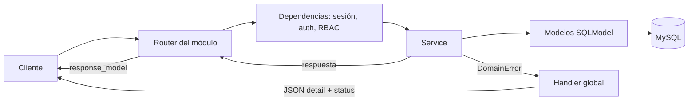

# Arquitectura del backend SAIP

## Objetivo

El backend pasó de una organización por tipo de archivo (`routers/`, `models/`,
`schemas/`) a una organización por dominio, con una capa de servicios que
concentra las reglas de negocio. La Fase 1 es un refactor: las rutas, schemas,
códigos HTTP y comportamiento público de la API no cambiaron.

## Estructura

```text
backend/
├── alembic/
│   └── env.py                  # Importa src.models_registry
├── src/
│   ├── main.py                 # Crea la app, CORS, rate limit y routers
│   ├── models_registry.py      # Registra los 22 modelos en SQLModel.metadata
│   ├── core/
│   │   ├── config.py           # Settings centralizados
│   │   ├── audit_context.py    # IP de origen para auditoría
│   │   ├── database.py         # engine y get_session
│   │   ├── dependencies.py     # get_current_user, require_module, require_admin
│   │   ├── email.py            # Envío de correos
│   │   ├── exceptions.py       # Excepciones de dominio
│   │   ├── schemas.py          # Mixins y schemas transversales
│   │   ├── security.py         # JWT, hashing, passwords temporales
│   │   └── time.py             # Zona horaria de Bogotá
│   ├── modules/
│   │   ├── audit/
│   │   ├── auth/
│   │   ├── commercial_products/
│   │   ├── health/
│   │   ├── inventory/
│   │   ├── production/
│   │   ├── products/
│   │   ├── providers/
│   │   ├── recipes/
│   │   ├── reports/
│   │   ├── roles/
│   │   ├── sales/              # Incluye state.py (transiciones y 24 h)
│   │   ├── stats/
│   │   ├── supplies/
│   │   ├── units/
│   │   └── users/
│   ├── bulk/
│   └── utils/
└── tests/
    ├── integration/
    ├── unit/
    └── snapshots/openapi_baseline.json
```

Cada módulo sigue el mismo patrón:

```text
modules/<dominio>/
├── models.py          # Modelos SQLModel del dominio
├── schemas.py         # Schemas Pydantic del dominio
├── router.py          # Endpoints y dependencias HTTP
├── service.py         # Reglas de negocio, consultas y transacciones
└── dependencies.py    # Factory del servicio con la sesión de BD
```

## Flujo de una petición



Los routers solo reciben la petición, resuelven dependencias, llaman al
servicio y devuelven la respuesta. Las reglas de negocio, validaciones de
estado, bloqueos y transacciones viven en `service.py`.

## Módulos

| Módulo | Responsabilidad | Rutas principales |
|---|---|---|
| `audit` | Registro inmutable y consulta de acciones críticas | `/audit/` |
| `auth` | Login, logout, recuperación y cambio de contraseña | `/session/*` |
| `users` | Usuarios, cuenta propia y borrado lógico | `/users/*` |
| `roles` | Roles, módulos y permisos RBAC | `/roles/*`, `/role-modules/*`, `/modules/*` |
| `units` | Unidades de medida | `/units/*` |
| `supplies` | Insumos y categorías de insumos | `/supplies/*`, `/supply-categories/*` |
| `commercial_products` | Productos comerciales y categorías | `/commercial-products/*`, `/product-categories/*` |
| `providers` | Proveedores y contactos | `/providers/*` |
| `products` | Productos terminados | `/products/*` |
| `recipes` | Recetas e ingredientes | `/recipes/*` |
| `production` | Órdenes de producción y consumo de insumos | `/production-orders/*` |
| `sales` | Ventas, ítems, anulación y exportación | `/sales/*` |
| `inventory` | Inventario consolidado y reportes | `/inventory/*` |
| `reports` | Reportes genéricos por entidad | `/reports/*` |
| `stats` | Estadísticas del dashboard | `/stats/*` |
| `health` | Healthcheck de aplicación y BD | `/health` |

## Excepciones de dominio

`src/core/exceptions.py` define `DomainError` y sus subtipos. Los servicios no
importan `HTTPException`. El handler global de `main.py` traduce cada excepción
a `JSONResponse({"detail": ...}, status_code=...)`.

| Excepción | HTTP |
|---|---|
| `NotFoundError` | 404 |
| `UnauthorizedError` | 401 |
| `PermissionDeniedError` | 403 |
| `BusinessRuleError` | 400 |
| `ConflictError` | 409 |
| `LockedError` | 423 |
| `ServerError` | 500 (o el código indicado) |

Las dependencias HTTP (`get_current_user`, `require_module`, `require_admin`)
siguen usando `HTTPException` porque forman parte de la capa de transporte.

## Registro de modelos y Alembic

`src/models_registry.py` importa todos los modelos para que
`SQLModel.metadata` los registre. `alembic/env.py` importa ese módulo y usa
`src.core.database.mysql_url`. La Fase 1 no modificó el esquema; la única
migración posterior es `756185c644ac`, que agrega las 6 FKs de auditoría que
faltaban en las migraciones históricas para igualar la metadata. Está validada
con `upgrade`, `downgrade` y `alembic check` sin cambios pendientes.

## Compatibilidad verificada

- El OpenAPI generado conserva los **59 paths** del baseline.
- Coinciden métodos, `operationId`, tags, parámetros, request bodies, responses
  y componentes de schema.
- Se conservaron los nombres originales de las funciones para no alterar los
  `operationId`.
- Se conservaron rutas, prefijos, códigos HTTP, defaults y alias de headers.
- `src/bulk/parser.py` ahora usa `src.core.schemas`.

## Pendientes de fases posteriores

- Fases 3 a 6: seguridad P1, reglas de negocio, testing y documentación ampliada.

Ya verificados en Fase 0/1: tests smoke y `conftest.py`, `alembic check` sin
cambios (tras la revisión `756185c644ac`), compose dev/prod y healthchecks.
Ya verificados en Fase 2: JWT sin fallback, CORS por entorno, `echo` desactivo,
política de contraseñas compartida con el frontend y enlaces de correo
configurables (detalle en `docs/FASE-2.md`).
